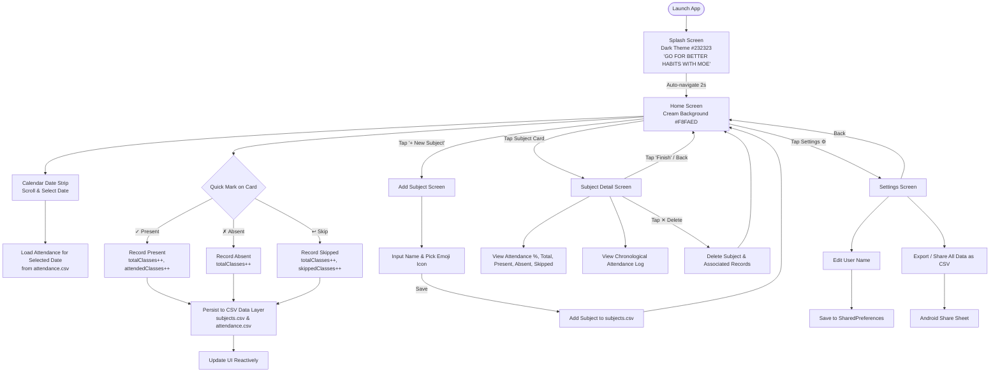

# 📊 Habit Tracker & Attendance Application — Flowchart & Task Division

## 1. High-Level Application Flow



---

## 2. Modular Architecture & Data Flow

```mermaid
graph TD
    subgraph UI Layer [UI Layer (Jetpack Compose)]
        SplashScreen[SplashScreen.kt]
        HomeScreen[HomeScreen.kt]
        CalendarStrip[CalendarStrip.kt]
        SubjectCard[SubjectCard.kt]
        AddSubjectScreen[AddSubjectScreen.kt]
        SubjectDetailScreen[SubjectDetailScreen.kt]
        SettingsScreen[SettingsScreen.kt]
        Theme[Theme.kt / Color.kt / Type.kt]
    end

    subgraph Navigation [Navigation Component]
        NavGraph[NavGraph.kt<br/>Routes: splash, home, add_subject, subject_detail/{id}, settings]
    end

    subgraph Domain Layer [Domain Layer (Pure Models)]
        SubjectModel[Subject.kt<br/>id, name, icon, total, attended, skipped, percentage]
        AttendanceModel[Attendance.kt<br/>id, subjectId, date, status: PRESENT/ABSENT/SKIPPED]
    end

    subgraph Data Layer [Data Layer (CSV Persistence)]
        SubjRepo[SubjectRepository.kt<br/>CRUD on subjects.csv]
        AttRepo[AttendanceRepository.kt<br/>CRUD on attendance.csv]
        SettingsRepo[SettingsRepository.kt<br/>Preferences]
        CsvMgr[CsvManager.kt<br/>Internal Storage File I/O]
    end

    subgraph File Storage [Device Internal Storage]
        CSV1[(subjects.csv)]
        CSV2[(attendance.csv)]
        Prefs[(SharedPreferences)]
    end

    UI Layer --> Navigation
    UI Layer --> Domain Layer
    UI Layer --> Data Layer
    SubjRepo --> CsvMgr
    AttRepo --> CsvMgr
    SettingsRepo --> Prefs
    CsvMgr --> CSV1
    CsvMgr --> CSV2
```

---

## 3. Divided Development Tasks (Iterative Git Push Strategy)

| Task ID | Task Description | Files Implemented / Scope | Git Branch / Commit |
|:---|:---|:---|:---|
| **TASK-01** | **Base Project Scaffold & Theme** | `build.gradle.kts`, `app/build.gradle.kts`, `settings.gradle.kts`, `AndroidManifest.xml`, `Color.kt`, `Theme.kt`, `Type.kt` with design tokens (`#232323`, `#5DA65C`, `#F8FAED`, `#A8D5A2`, `#E85D3A`, `#7BB8D6`). | `master` (`init/scaffold`) |
| **TASK-02** | **Data Models & CSV Storage Layer** | `Subject.kt`, `Attendance.kt`, `AttendanceStatus`, `CsvManager.kt`, `SubjectRepository.kt`, `AttendanceRepository.kt`, `SettingsRepository.kt`. | `feature/csv-data-layer` |
| **TASK-03** | **Splash & Home Navigation** | `SplashScreen.kt`, `NavGraph.kt`, `MainActivity.kt`. Splash screen matching visual reference with animated transition. | `feature/splash-navigation` |
| **TASK-04** | **Home Screen UI & Calendar Strip** | `HomeScreen.kt`, `CalendarStrip.kt` with day-of-week strip, date selection, motivational quote bubble. | `feature/home-calendar-ui` |
| **TASK-05** | **Subject CRUD & Card Components** | `SubjectCard.kt`, `AddSubjectScreen.kt` with icon picker (📚, 📐, 🧪, 💻, etc.), and quick action buttons. | `feature/subject-crud` |
| **TASK-06** | **Attendance Marking Engine** | Interactive Present / Absent / Skipped recording, reactive CSV updates, attendance percentage calculation. | `feature/attendance-engine` |
| **TASK-07** | **Subject Detail & History View** | `SubjectDetailScreen.kt` with breakdown statistics, attendance percentage badge, history list, delete subject action. | `feature/subject-detail` |
| **TASK-08** | **Settings & CSV Data Export** | `SettingsScreen.kt` with user name customization and direct CSV export via Android Intent share. | `feature/settings-export` |
| **TASK-09** | **APK Build & Release Verification** | Gradle build execution, generating standalone testable APK artifact. | `release/v0.1` |
